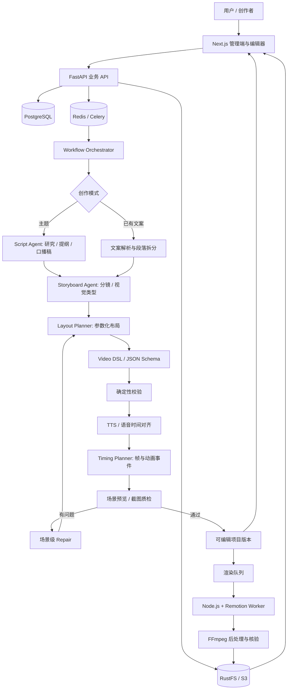
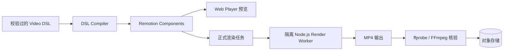
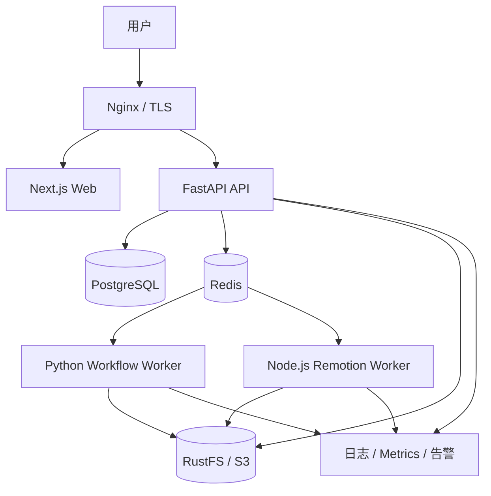

# AI 动态知识视频生产平台：技术架构设计

> 版本：v1.1（架构草案；首版执行细节见 [MVP 开发契约](./MVP开发契约.md)）  
> 定位：自动生成知识讲解型动态图解视频，支持「主题全自动生成」与「文案驱动生成 + 人工编辑」两种模式。  
> 目标样式：技术知识讲解、结构化图解、逐步显现的动画、中文 AI 配音与同步字幕。

## 1. 目标与架构原则

### 1.1 核心能力

- **模式 A：主题生成**——输入主题、受众、时长、风格，由 AI 生成口播稿、分镜、动态图解、配音和视频。
- **模式 B：文案生成**——输入已有口播稿、文章或知识内容，AI 保留核心原意，自动制作视频。
- **人工编辑**——支持修改脚本、场景类型、图解元素、场景顺序、主题与配音；局部重生成。
- **统一导出**——预览与正式导出复用动画组件，生成 1080P MP4 和字幕文件。

### 1.2 设计原则

1. **DSL 为中心**：AI 输出可校验的场景描述，不直接输出整段视频。
2. **模板优先、自由生成兜底**：MVP 用参数化图解组件保证稳定性；后续补充受限自定义动画能力。
3. **两种模式共用下游**：仅脚本生产方式不同，分镜到渲染使用相同链路。
4. **Agent 负责编排与选择，代码负责确定性执行**：布局、时间换算、Schema 校验、媒体处理尽量程序化。
5. **场景级可重试、可编辑、可缓存**：避免一个场景失败导致整个项目重新制作。
6. **内容、语音、时间轴、画面分离存储**：保证人工编辑和迭代能力。

## 2. 总体架构



### 2.1 分层职责

| 层 | 模块 | 职责 | 推荐技术 |
|---|---|---|---|
| 交互层 | 管理后台、分镜编辑器、视频播放器 | 项目、脚本、场景编辑与预览 | Next.js、React、Remotion Player |
| 服务层 | 业务 API | 鉴权、版本、资源、任务管理 | FastAPI、Pydantic |
| 编排层 | AI Workflow | 脚本、分镜、布局、质检与修复 | Python 工作流 / 可演进为 LangGraph |
| 协议层 | Video DSL | 场景、元素、时序、资源、主题的统一描述 | JSON Schema、TypeScript 类型 |
| 语音层 | TTS、强制对齐、字幕 | 生成语音及词/短语级时间戳 | 可替换 TTS 服务、字幕对齐工具 |
| 渲染层 | 组件库、预览、导出 | DSL → React/SVG 动画 → 视频 | Remotion、Node.js |
| 媒体层 | 视频检测与后处理 | 转码、合成、封装、字幕文件 | FFmpeg / ffprobe |
| 基础设施 | 状态、队列、存储 | 任务、版本、素材、产物 | PostgreSQL、Redis、Celery、RustFS/S3 |

## 3. 核心数据流

### 3.1 主题全自动模式

```text
输入主题 + 受众 + 目标时长
  → 资料检索 / 事实核验（按需）
  → 提纲与口播稿
  → 口播分段
  → 分镜清单
  → 每场景视觉结构 DSL
  → 校验 + TTS
  → 音频时间戳 → 动画帧事件
  → 场景预览 + QA
  → 可编辑项目版本
  → 正式渲染 → MP4
```

### 3.2 文案驱动模式

```text
输入口播稿 / 文章
  → 文案清洗、保留原意、划分讲解段落
  → 分镜清单
  → [与全自动模式相同的后续链路]
```

**人工检查点**：可配置在「口播稿生成后」「分镜生成后」「正式导出前」，不要为每一步强制人工审批。

## 4. 核心 Agent / 工作流节点

> MVP 建议采用**有状态工作流 + 专业化 LLM 节点**，不必一开始构造多个自治 Agent 彼此对话。

| 节点 | 输入 | 输出 | 核心约束 |
|---|---|---|---|
| Input Router | 主题或文案、模式配置 | 生成任务参数 | 标识自动/文案模式 |
| Script Agent | 主题、受众、时长、知识参考 | 提纲、口播稿 | 技术事实可核验，长度可控 |
| Script Parser | 用户原稿 | 段落、关键词、原文引用 | 不擅自改变观点 |
| Storyboard Agent | 口播段落 | 场景列表、视觉意图、场景类型 | 先规划场景再展开细节 |
| Layout Planner | 场景类型、元素数据 | 布局参数、元素关系 | 优先规则布局、避免自由绝对坐标 |
| TTS Service | 场景口播 | 语音文件、实际时长 | 音频资产版本化 |
| Alignment Service | 文稿、语音 | 词/短语时间戳 | 不依赖固定字数估时 |
| Timing Planner | 时间戳、视觉元素 | 动画事件、场景帧数 | 所有事件在场景范围内 |
| Schema Validator | DSL | 错误列表 | 纯代码校验、快速反馈 |
| Visual QA | 关键帧、分镜说明 | 问题类型及 scene_id | 检查遮挡、溢出、错图 |
| Repair Node | 单场景问题 | 修复后的场景 DSL | 限制重试次数，仅改问题场景 |

### 4.1 推荐的两阶段分镜生成

第一阶段生成全片 `scene_outline`，包括每一段要解释的概念、适用图解类型和对应口播区间；第二阶段单独为每个场景生成 `scene_dsl`。这样便于针对失败场景重试，并减少长上下文生成造成的不一致。

### 4.2 图解类型库（MVP）

- `title_reveal`：开场标题
- `keyword_highlight`：关键词突出
- `card_sequence`：知识卡片逐步显现
- `flow_diagram`：流程图
- `layer_diagram`：分层架构
- `comparison_panel`：方案对比
- `step_timeline`：步骤/时间轴
- `code_walkthrough`：代码逐行讲解

P1 再增加动态图表、关系网络、矩阵、漏斗图等。

## 5. Video DSL 规范

DSL 是整个系统的中心契约，前端编辑器、Agent 和渲染器均围绕同一 Schema 协作。

### 5.1 主要实体

```text
VideoProject
  ├── schema_version
  ├── video_config: width / height / fps / language
  ├── theme: palette / typography / spacing / subtitle_style
  ├── assets: audio / image / font / music
  └── scenes[]
       ├── id / order / type
       ├── narration: text / audio_asset_id
       ├── duration_frames
       ├── elements[]: id / type / content / layout
       ├── animations[]: target / effect / start_frame / duration_frames
       └── captions[]: text / start_frame / end_frame
```

### 5.2 DSL 示例

```json
{
  "schema_version": "1.0",
  "video_config": {"width": 1920, "height": 1080, "fps": 30},
  "theme": "tech_explainer",
  "scenes": [
    {
      "id": "scene_003",
      "order": 3,
      "type": "layer_diagram",
      "narration": {
        "text": "意图识别分为规则匹配、轻量分类和大模型兜底。",
        "audio_asset_id": "audio_scene_003"
      },
      "duration_frames": 225,
      "elements": [
        {"id": "a", "type": "card", "content": "规则匹配", "layout": {"slot": "top"}},
        {"id": "b", "type": "card", "content": "轻量意图分类", "layout": {"slot": "middle"}},
        {"id": "c", "type": "card", "content": "大模型兜底", "layout": {"slot": "bottom"}}
      ],
      "animations": [
        {"target": "a", "effect": "fade_slide", "start_frame": 15, "duration_frames": 12},
        {"target": "b", "effect": "fade_slide", "start_frame": 70, "duration_frames": 12},
        {"target": "c", "effect": "fade_slide", "start_frame": 125, "duration_frames": 12}
      ],
      "captions": []
    }
  ]
}
```

### 5.3 校验策略

1. **结构校验**：JSON Schema 字段、枚举类型、缺失资源、`target` 对应元素。
2. **时间校验**：总帧数为正；每个动画、字幕事件的区间不超出场景。
3. **布局校验**：节点数量与模板限制、文本长度、最小字号、画布安全边界。
4. **预览校验**：场景关键帧截图；检测文字重叠、元素遮挡和内容不匹配。
5. **版本兼容**：`schema_version` 必需；新字段向后兼容或提供迁移器。

## 6. 音视频时序架构

### 6.1 为什么先有音频再定时长

不要依赖预估字数强行决定场景时长。推荐：

```text
场景讲解稿
  → TTS 合成
  → 实际音频时长
  → 词/短语时间对齐
  → 关键讲解概念绑定视觉元素 ID
  → 时间戳转帧号 (frame = round(seconds * fps))
  → 生成入场、强调、退场动画事件
  → 场景帧数 = 音频帧数 + 合理头尾留白
```

### 6.2 动画执行规则

- 动画参数由 `useCurrentFrame()` 等按帧计算，避免真实定时器驱动。
- 同一音频/DSL/主题版本应得到确定性的渲染输出。
- 关键视觉元素围绕对应讲解词句逐步出现，而不是场景开始时一次性出现。
- 保留字幕安全区，避免底部卡片遮住字幕。

## 7. 渲染架构



### 7.1 组件库边界

- `components/`：Title、Card、Flow、Layer、Comparison、Timeline、Code 等通用模板。
- `themes/`：字体、配色、网格、动画预设、字幕样式。
- `compiler/`：DSL 对应模板的参数归一化与语义校验。
- `compositions/`：全片 Scene/Sequence 编排和音频轨。
- `render-worker/`：正式视频渲染、超时、资源限制、进度上报。

### 7.2 增量渲染策略

**MVP：** 全片作为一个 Remotion Composition 导出，降低音频、转场和编码复杂度。  
**后续：** 对无跨场景转场的场景片段做缓存和局部渲染，再进行无缝拼接；必须统一编码、帧率与时间基。

### 7.3 自定义代码边界

MVP 不执行 LLM 自由生成的 React/JS 代码。需要扩展独特图解时，先添加审核过的新模板。未来如引入 AI 代码生成，应在**无密钥、无宿主文件系统写入权限、网络受限、资源限额**的沙箱中编译与渲染。

## 8. 前端编辑器架构

### 8.1 页面结构

```text
项目列表
  └── 项目工作台
       ├── 脚本编辑区
       ├── 场景列表与排序
       ├── Remotion Player 预览区
       ├── 场景属性面板（图解类型 / 节点 / 文案 / 风格）
       ├── 场景级时间轴
       └── 导出 / 版本历史
```

### 8.2 MVP 编辑范围

- 修改某段口播并重新配音。
- 更换图解组件类型、调整节点内容。
- 重排场景、调整字幕及主题样式。
- 单场景重新生成，不覆盖其他人工编辑。
- 项目版本快照、预览和导出。

不做复杂多轨 NLE 编辑器。场景属性编辑优先于任意元素自由拖拽。

### 8.3 AI 与人工编辑冲突处理

场景保留 `generated_revision` 与 `user_revision`，所有导出绑定不可变项目版本。AI 再生成某个场景时，默认只提出候选修改，由用户明确选择替换，不覆盖人工改动。

## 9. 后端数据模型与 API

### 9.1 数据模型

| 表 | 关键字段 | 用途 |
|---|---|---|
| `projects` | id, title, mode, status, config | 项目元数据 |
| `scripts` | project_id, source_text, generated_text, revision | 文案及版本 |
| `scenes` | id, project_id, order, type, dsl_jsonb, revision | 场景 DSL |
| `assets` | id, project_id, type, storage_key, checksum | 配音、图片、音乐等 |
| `jobs` | id, type, status, attempts, error, idempotency_key | 长任务状态 |
| `renders` | id, project_version_id, profile, storage_key, status | 导出结果 |
| `project_versions` | id, project_id, snapshot, created_at | 不可变快照 |

### 9.2 API 草案

```http
POST   /api/projects
GET    /api/projects/{id}
POST   /api/projects/{id}/generate
GET    /api/jobs/{job_id}
GET    /api/projects/{id}/scenes
PATCH  /api/scenes/{scene_id}
POST   /api/scenes/{scene_id}/regenerate
POST   /api/scenes/{scene_id}/voice
POST   /api/scenes/{scene_id}/preview
POST   /api/projects/{id}/render
GET    /api/renders/{render_id}
POST   /api/projects/{id}/versions
GET    /api/projects/{id}/versions
```

后台异步任务返回 `job_id`，使用轮询或 SSE 获取进度；不占用长期 HTTP 连接直到视频生成完成。

## 10. 任务编排、容错与幂等

### 10.1 状态机

```text
queued → running → validating → succeeded
                    ↘ failed
                    ↘ cancelled
```

### 10.2 稳定性要求

- 任务以 `project_version + render_profile + asset_hash` 等组成幂等键。
- 场景级重试、指数退避、有上限的 AI 修复次数。
- 使用稳定对象存储 key，不依赖容器本地临时文件作为持久资产。
- 独立记录各阶段耗时、Token、TTS 时长、渲染时长、失败类型。
- `Celery + Redis` 适合 MVP；人工审批后长期恢复等复杂工作流可后续演进至 Temporal 等。

## 11. 部署架构



### 11.1 Docker Compose 服务

```text
web              Next.js
api              FastAPI
workflow-worker  Celery + LLM/TTS 调用
render-worker    Node.js + Remotion + Chromium / FFmpeg
postgres         PostgreSQL
redis            Redis
rustfs           私有对象存储（或外部 S3；替代已归档的旧MinIO社区服务）
reverse-proxy    Nginx/Caddy
```

### 11.2 运维约束

1. Worker 独立容器，设置 CPU、内存、并发、任务超时和进程回收。
2. 设置 Docker 日志轮转，渲染缓存与临时文件 TTL，定时清理失败残留。
3. 对磁盘容量、容器内存、队列积压和任务失败率设置告警。
4. 对外提供签名资源 URL；对象存储和 Redis 不直接暴露公网。
5. 生成期间产生的日志、临时帧和下载素材需要单独的存储预算。
6. 根据实际商业使用场景核对 Remotion 许可，以及所选字体、配音、音乐的商业授权。

## 12. 推荐代码目录

```text
video-platform/
├── apps/
│   ├── web/                      # Next.js 编辑器
│   ├── api/                      # FastAPI
│   └── renderer/                 # Remotion & Node 渲染服务
├── packages/
│   ├── video-schema/            # JSON Schema、TS 类型、迁移器
│   ├── video-components/        # 视觉组件
│   ├── video-themes/            # 主题和排版规范
│   └── video-player/            # Player 包装与预览
├── services/
│   ├── workflow/                # Agent / 任务状态机
│   ├── tts/                     # TTS & alignment
│   └── media/                   # FFmpeg / ffprobe
├── infrastructure/
│   ├── compose.yaml
│   └── migrations/
└── docs/
    ├── video-dsl.md
    ├── agent-workflow.md
    └── operations.md
```

## 13. MVP 实施路线

> 下表保留原始完整 MVP 估算，不作为首版交付承诺。首版已确认采用单用户、本地部署、文案驱动和 3 类模板；以 [MVP 开发契约](./MVP开发契约.md) 的分阶段验收与范围为准。

| 阶段 | 核心任务 | 验收产物 |
|---|---|---|
| Week 1 | DSL v1、3 个组件、Remotion 导出 | 手写 JSON → 30–60 秒 MP4 |
| Week 2 | Storyboard Agent、场景选择、补至 8 种组件 | 文案 → 自动分镜 DSL |
| Week 3 | TTS、字幕、时间戳、动画同步 | 完整音画同步演示视频 |
| Week 4 | Next.js 场景编辑器、预览、局部生成 | 可编辑、可重生成场景 |
| Week 5 | Celery 队列、版本、容错、日志、QA | 可试用的端到端 MVP |

以上工期为小型熟练团队的规划估算，最终取决于组件设计品质、TTS 接入及渲染硬件。

### 13.1 不纳入 MVP

- 完整多轨专业剪辑、任意图生视频、骨骼动画。
- 多模型自主互相讨论式 Agent 编排。
- LLM 在生产容器中执行自由生成代码。
- 复杂的逐场景分布式拼接和缓存复用。

### 13.2 MVP 验收标准

- 输入一篇约 60 秒的 Agent 技术讲解稿，自动生成至少 5 个动态图解场景。
- 可以生成中文配音、同步字幕、1080P / 30FPS MP4。
- 可以修改单个场景并保留其他场景的人工编辑。
- 20 个代表性输入中至少 18 个能完成可播放导出（初步工程验收目标）。
- 校验无画布越界、无明显文字重叠，关键视觉事件与讲解语句尽量控制在约 0.5 秒偏差内。
- 任务失败能够定位到阶段和 `scene_id`，并可安全重试。

## 14. 推荐落地顺序与关键决策

**最先验证的闭环**：

```text
一份 60 秒中文讲解稿
  → 5 个自动分镜
  → 8 类可复用动画组件
  → TTS 与帧级对齐
  → 在线预览及单场景编辑
  → MP4 导出
```

优先做深「技术讲解动态图解」这一类视频，统一配色、排版、字幕与动画语言，再扩展其他风格。前期最高价值的两项资产是 **Video DSL 协议** 与 **高质量图解组件库**；Agent 的能力建立在它们之上，而不是反过来。
